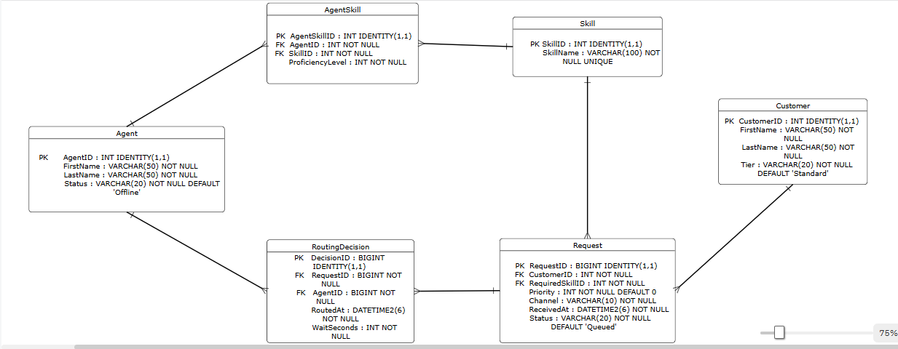

# QueueFlow – Real-Time Contact Center Queue & Live Agent Routing System

## Project Overview

QueueFlow is a Real-Time Contact Center Queue and Live Agent Routing System developed as part of the Hexaware Incremental Capstone Project.

The system aims to manage incoming customer requests and assign them to suitable available agents based on skills, priority, and waiting time.

## Project Objectives

- Manage customer requests efficiently.
- Match requests with agents based on required skills.
- Consider request priority and waiting time during routing.
- Maintain agent availability and request status.
- Record routing decisions for tracking and analysis.

## Technology Stack

- **Programming Language:** Python 3.13
- **Database:** Microsoft SQL Server
- **Database Connectivity:** pyodbc
- **Version Control:** Git and GitHub
- **Project Management:** Jira

## Project Structure

```text
Incremental-Capstone-QueueFlow/
│
├── QueueFlow/
│   ├── entity/
│   ├── dao/
│   ├── exception/
│   ├── util/
│   ├── main/
│   └── tests/
│
├── database/
│   ├── queueflow_schema_and_sample_data.sql
│   └── queueflow_constraint_testing.sql
│
├── docs/
│   └── QueueFlow_ER_Diagram.png
│
└── README.md
```

## Database Design

The project uses a SQL Server database named `QueueFlowDB` with six main tables:

1. Agent
2. Skill
3. AgentSkill
4. Customer
5. Request
6. RoutingDecision

The database uses Primary Keys, Foreign Keys, UNIQUE constraints, CHECK constraints, DEFAULT constraints, and indexes to maintain data integrity.

## Entity Relationship Diagram



## Sprint Plan

| Sprint | Focus Area |
|---|---|
| Sprint 1 | Database Design |
| Sprint 2 | Object-Oriented Programming |
| Sprint 3 | Advanced Programming |
| Sprint 4 | Integration & Testing |

## Current Progress

### Sprint 1 – Database Design

- [x] GitHub repository and project structure setup
- [x] Database schema implementation
- [x] Sample data population
- [x] Database validation and constraint testing
- [x] Entity Relationship Diagram creation

*Remaining sprint activities and review updates will be tracked through Jira.*

## Repository

GitHub: https://github.com/divyasree-t-dev/Incremental-Capstone-QueueFlow
